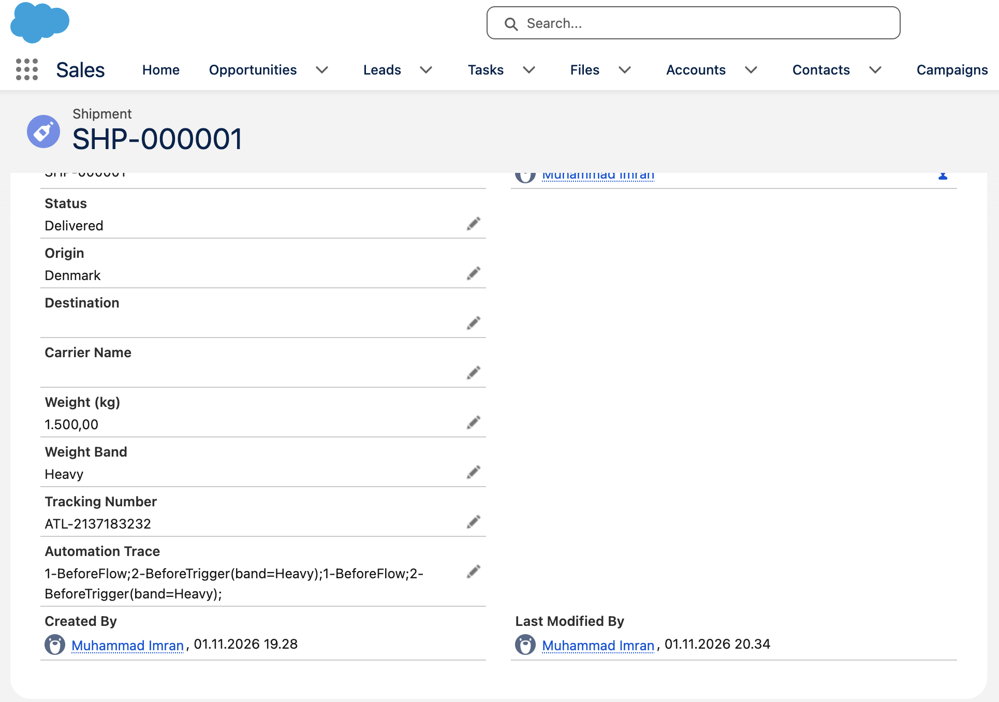

# Order of Execution Lab: Shipment__c

**Week 2 build.** Goal: prove, with evidence from a real org, the order in which Salesforce runs record-triggered flows, Apex triggers, validation rules and duplicate rules on a single save.

Reference: [Triggers and Order of Execution](https://developer.salesforce.com/docs/atlas.en-us.apexcode.meta/apexcode/apex_triggers_order_of_execution.htm)

## Setup

Six automations on `Shipment__c`, each leaving evidence of when it ran.

| # | Automation | What it does | Evidence it leaves |
|---|---|---|---|
| 1 | Before-save flow `Shipment_Before_Save` | Sets `Weight_Band__c` from `Weight_kg__c`, appends `1-BeforeFlow;` to `Automation_Trace__c` | Trace field |
| 2 | Before trigger `ShipmentTrigger` → `ShipmentTriggerHandler.beforeSave` | Fills `Tracking_Number__c` if blank, appends `2-BeforeTrigger(band=<Weight_Band__c>);` | Trace field, debug log |
| 3 | Validation rules | `Origin_And_Destination`, `Tracking_Number_should_not_be_empty`, `Valid_Wait` (weight > 0) | `VALIDATION_RULE` lines |
| 4 | Duplicate rule `Block_Duplicate_Tracking_Number` | Blocks a second shipment with the same tracking number | `DuplicateDetector` code unit |
| 5 | After trigger → `ShipmentTriggerHandler.afterSave` | Creates a Task when Status becomes Exception | `USER_DEBUG 5-AfterTrigger` |
| 6 | After-save flow `Shipment_After_Save` | Creates a "Send delivery survey" Task when Status becomes Delivered (runs only when the record is updated to meet the condition) | `FLOW_START_INTERVIEW` lines |

## Evidence 1: Status changed from Draft to Delivered

Shipment `SHP-000001`, weight 1,500 kg. Debug level: Apex Code DEBUG, Validation INFO, Workflow FINER, DB INFO. Excerpt from the log, trimmed, with personal identifiers removed. Times are milliseconds from the start of the transaction.

```
  0.6 ms  CODE_UNIT_STARTED  ShipmentTrigger on Shipment trigger event BeforeUpdate   ← 2 before trigger
 10.0 ms  CODE_UNIT_FINISHED ShipmentTrigger ... BeforeUpdate
 13.2 ms  CODE_UNIT_STARTED  Validation:Shipment:a00g800002ZZbtx                       ← 3 validation rules
          VALIDATION_RULE    Origin_And_Destination
          VALIDATION_FORMULA Origin__c = Destination__c | Origin__c=Denmark, Destination__c=null
          VALIDATION_PASS
          VALIDATION_RULE    Tracking_Number_should_not_be_empty
          VALIDATION_FORMULA ISBLANK(Tracking_Number__c) | Tracking_Number__c=ATL-2137183232
          VALIDATION_PASS
          VALIDATION_RULE    Valid_Wait
          VALIDATION_FORMULA Weight_kg__c <= 0 | Weight_kg__c=1500
          VALIDATION_PASS
 13.5 ms  CODE_UNIT_FINISHED Validation:Shipment
 14.4 ms  CODE_UNIT_STARTED  DuplicateDetector                                         ← 4 duplicate rule
 90.1 ms  CODE_UNIT_FINISHED DuplicateDetector
112.1 ms  CODE_UNIT_STARTED  ShipmentTrigger on Shipment trigger event AfterUpdate     ← 5 after trigger
          USER_DEBUG         5-AfterTrigger, records in chunk: 1
113.3 ms  CODE_UNIT_FINISHED ShipmentTrigger ... AfterUpdate
122.0 ms  CODE_UNIT_STARTED  Flow:01Ig800000643VJ                                      ← 6 after-save flow
          FLOW_START_INTERVIEW_BEGIN  Shipment After Save
          FLOW_VALUE_ASSIGNMENT $Record | Status__c=Delivered, Weight_Band__c=Heavy,
              Automation_Trace__c=1-BeforeFlow;2-BeforeTrigger(band=Heavy);1-BeforeFlow;2-BeforeTrigger(band=Heavy);
          FLOW_ELEMENT_BEGIN    FlowRecordCreate | Create_Survey_Task
          FLOW_ELEMENT_DEFERRED FlowRecordCreate | Create_Survey_Task
          FLOW_BULK_ELEMENT_BEGIN FlowRecordCreate | Create_Survey_Task
          FLOW_BULK_ELEMENT_LIMIT_USAGE 1 DML statements, total 1 out of 150
          FLOW_INTERVIEW_FINISHED Shipment After Save
280.3 ms  CODE_UNIT_FINISHED Flow:01Ig800000643VJ
327.9 ms  EXECUTION_FINISHED
```

### What it proves

| Step | Log evidence | Conclusion |
|---|---|---|
| Before-save flow → before trigger | The record's trace (in the after-save flow's `$Record`) gained `1-BeforeFlow;2-BeforeTrigger(band=Heavy);` in this save, and the trigger's marker contains `band=Heavy`, a value set by the flow | The flow ran first, and the trigger read what it set |
| Before trigger → validation | `BeforeUpdate` finished at 10.0 ms; validation started at 13.2 ms | Validation sees values set by before automation (shown directly in Evidence 3) |
| Validation → duplicate rule | Validation finished at 13.5 ms; `DuplicateDetector` started at 14.4 ms | Duplicate rules run after validation passes |
| Duplicate rule → after trigger | `DuplicateDetector` finished at 90.1 ms; `AfterUpdate` started at 112.1 ms | The record is saved (not committed) between the two |
| After trigger → after-save flow | `AfterUpdate` finished at 113.3 ms; the flow started at 122.0 ms | After-save flows run after after triggers |
| Change detection | The flow ran because Status changed Draft → Delivered (`old` Status in the trigger debug was `Draft`) | "Only when a record is updated to meet the condition requirements" fires once per transition |

## Evidence 2: Record trace field

`SHP-000001` after two saves: created as Draft, then updated to Delivered (the save in Evidence 1).



| Field | Value | What it shows |
|---|---|---|
| Weight Band | Heavy | Set by the before-save flow from 1,500 kg |
| Tracking Number | ATL-2137183232 | Generated by the before trigger on create |
| Automation Trace | `1-BeforeFlow;2-BeforeTrigger(band=Heavy);1-BeforeFlow;2-BeforeTrigger(band=Heavy);` | One flow → trigger pair per save, always in that order, and the trigger read the band the flow had just set |

The after-save automations leave no mark here: they can't change the record without an extra DML, which would run the whole save again.

## Evidence 3: Validation failure stops everything after it

New shipment created in the UI with Origin and Destination left blank, weight 40 kg, and **no tracking number entered**. Debug level as in Evidence 1. Excerpt:

```
 0.4 ms  CODE_UNIT_STARTED  ShipmentTrigger on Shipment trigger event BeforeInsert    ← 2 before trigger
 5.5 ms  CODE_UNIT_FINISHED ShipmentTrigger ... BeforeInsert
 8.8 ms  CODE_UNIT_STARTED  Validation:Shipment:new                                   ← 3 validation rules
         VALIDATION_RULE    Origin_And_Destination
         VALIDATION_FORMULA Origin__c = Destination__c | Origin__c=null, Destination__c=null
         VALIDATION_FAIL                                                              ← save fails here
         VALIDATION_RULE    Tracking_Number_should_not_be_empty
         VALIDATION_FORMULA ISBLANK(Tracking_Number__c) | Tracking_Number__c=ATL-1047599101
         VALIDATION_PASS                                                              ← number set by the trigger
         VALIDATION_RULE    Valid_Wait
         VALIDATION_FORMULA Weight_kg__c <= 0 | Weight_kg__c=40
         VALIDATION_PASS
 9.1 ms  CODE_UNIT_FINISHED Validation:Shipment:new
16.5 ms  CODE_UNIT_FINISHED TRIGGERS
16.5 ms  EXECUTION_FINISHED
```

### What it proves

| Observation | Conclusion |
|---|---|
| No tracking number was entered, yet `Tracking_Number_should_not_be_empty` saw `ATL-1047599101` and passed | **Direct proof** that the before trigger runs before validation rules: the trigger filled the field, and validation checked the trigger's value |
| All three rules were evaluated after the first `VALIDATION_FAIL` | Salesforce evaluates every validation rule and returns all errors together, rather than stopping at the first failure |
| No `DuplicateDetector`, no `AfterInsert`, no after-save flow | A validation failure stops the save at step 3; duplicate rules and everything after them never run |
| The whole transaction took 16.5 ms, against 328 ms for the successful save in Evidence 1 | Failing at validation is cheap; the expensive steps (duplicate check, after automation, DML) were skipped |

## Evidence 4: Duplicate rule blocks the save

Execute Anonymous, inserting a shipment with Status = Exception and the tracking number of `SHP-000001`:

```apex
insert new Shipment__c(
    Status__c = 'Exception',
    Origin__c = 'Copenhagen, DK',
    Destination__c = 'Oslo, NO',
    Carrier_Name__c = 'NordFreight',
    Weight_kg__c = 100,
    Tracking_Number__c = 'ATL-2137183232'
);
```

Debug level: Apex Code FINEST, Apex Profiling INFO (no Workflow or Validation detail). Excerpt, trimmed:

```
 53.2 ms  CODE_UNIT_STARTED  Flow:01Ig800000643VJ                                      ← 1 before-save flow
 76.5 ms  CODE_UNIT_FINISHED Flow:01Ig800000643VJ
 83.9 ms  CODE_UNIT_STARTED  ShipmentTrigger on Shipment trigger event BeforeInsert    ← 2 before trigger
          METHOD_ENTRY       ShipmentTriggerHandler.beforeSave(List<Shipment__c>)
          VARIABLE_ASSIGNMENT records | [{"Automation_Trace__c":"1-BeforeFlow;",
              "Weight_Band__c":"Standard", "Tracking_Number__c":"ATL-2137183232",
              "Status__c":"Exception", "Weight_kg__c":100.00, ...}]
          VARIABLE_ASSIGNMENT this.Automation_Trace__c | "1-BeforeFlow;2-Befor (25 more) ..."
 91.7 ms  CODE_UNIT_FINISHED ShipmentTrigger ... BeforeInsert
 93.8 ms  CODE_UNIT_STARTED  Validation:Shipment:new                                   ← 3 validation rules (pass)
 93.9 ms  CODE_UNIT_FINISHED Validation:Shipment:new
 94.9 ms  CODE_UNIT_STARTED  DuplicateDetector                                         ← 4 duplicate rule
185.9 ms  CODE_UNIT_FINISHED DuplicateDetector
190.4 ms  EXCEPTION_THROWN   System.DmlException: Insert failed. First exception on row 0;
                             first error: DUPLICATES_DETECTED, A shipment with this tracking number already exists.
192.9 ms  FATAL_ERROR
193.0 ms  EXECUTION_FINISHED
```

### What it proves

| Observation | Conclusion |
|---|---|
| The trigger's input `records` already contains `Automation_Trace__c = "1-BeforeFlow;"` and `Weight_Band__c = "Standard"` | **Direct proof** that the before-save flow ran before the before trigger: the trigger received the flow's values |
| Before trigger → validation → `DuplicateDetector`, then the exception | Duplicate rules run after before triggers and validation, before the record is saved |
| **No `AfterInsert` code unit and no after-save flow** | A duplicate block stops the save before step 5, so nothing after it runs |
| Status was `Exception`, yet no Task was created | The after trigger's Exception logic never ran, and nothing from the before phase was committed |
| `Number of DML statements: 1 out of 150` | A blocked DML still counts against the limit |

## Observations

1. **Flow code units are named after the object, not the flow.** `Flow:01Ig800000643VJ` uses the Shipment__c object's Id (prefix `01I` = custom object), so the same name wraps both flows. In Evidence 4 the before-save flow shows up as that code unit just before `BeforeInsert`, with no detail because Workflow logging was off. In Evidence 1 (a UI update) no code unit appears before `BeforeUpdate` at all. The trace field and the trigger's input values are the reliable evidence for the before-save flow.
2. **The duplicate rule was the slowest step.** `DuplicateDetector` took about 76 ms (Evidence 1) and 91 ms (Evidence 4) on a single record, more than both triggers combined, because it queries for matching records. At high volume (week 3: 5M events/day) duplicate rules on Shipment would need careful thought.
3. **Flows bulkify their DML.** `Create_Survey_Task` is first logged as `FLOW_ELEMENT_DEFERRED`, then executed in `FLOW_BULK_ELEMENT_BEGIN`: the flow collects the Task inserts from all interviews in the batch and runs one DML.
4. **Trace field accumulates history.** Each save appends a new `1-BeforeFlow;2-BeforeTrigger(...)` pair, so the field also shows how many times the record has been saved through the UI or API.
5. **Lightning shows duplicate warnings before Save.** Typing an existing tracking number shows a warning in the form immediately. That's a read-only UI lookup, separate from the duplicate rule that runs at step 4 during the save, which is the one that enforces the block on every channel (UI, API, Apex).
6. **Testing statics needs `@TestSetup`.** The handler's `static Set<Id>` recursion guard persists for the whole transaction, including a whole test method. Insert-then-update in one test method would skip the update, so update tests use records created in `@TestSetup`.

## Issues found during the lab

- `Origin_And_Destination` behaves inconsistently with blanks. In Evidence 3 it **failed** with both fields blank (in formulas, blank equals blank), so the user saw "Origin and Destination cannot be Same" for a record with no route at all. In Evidence 1 it **passed** with only Destination blank. Fix: make Origin and Destination required fields, and change the formula to `AND(NOT(ISBLANK(Origin__c)), Origin__c = Destination__c)` so it only checks what it says.
- Rename `Valid_Wait` to `Valid_Weight` and fix its error message ("Wait should be more than 0Kg").
- The debug line `old map in insertt:` in `afterSave` runs on updates too and is misleading. Remove it or rename it before the week 22 refactor.

## What I'd do differently

- Make `Tracking_Number__c` **Unique** in week 7, when it becomes the upsert key. Duplicate rules are for fuzzy business duplicates; identifiers belong in a database constraint.
- Move to a trigger framework (one trigger → handler → service) in week 22, splitting `afterSave` into `afterInsert` and `afterUpdate`.
